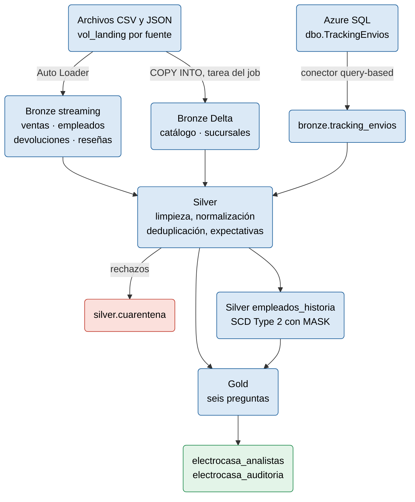
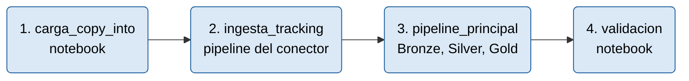

# ElectroCasa Lakehouse

Plataforma de datos de punta a punta sobre Azure Databricks para ElectroCasa, una cadena de 40 tiendas de electrodomésticos en Perú. Integra seis fuentes heterogéneas en un modelo Medallion con Lakeflow Spark Declarative Pipelines, orquesta todo con Lakeflow Jobs, lo gobierna con Unity Catalog y lo despliega con un Declarative Automation Bundle de dos targets.

Los datos, las sucursales y las personas del caso son ficticios.

## Cómo revisar este repositorio

Cada pauta del enunciado y dónde se cumple:

| Pauta del enunciado | Dónde está |
|---|---|
| Repositorio con `databricks.yml`, `resources/`, `src/`, `contratos/`, `notebooks/00_setup.ipynb` y README | Raíz del repositorio ([sección 3](#3-estructura-del-repositorio)) |
| Catálogo propio, schemas por capa y volume de landing | `notebooks/00_setup.ipynb` ([sección 9](#9-gobierno-y-seguridad)) |
| Al menos dos métodos de ingesta de archivos, justificados | Auto Loader en `src/electrocasa/transformations/bronze.py` (por metadata, con `src/electrocasa/config/fuentes_auto_loader.json`) y COPY INTO en `notebooks/01_carga_copy_into.ipynb` ([sección 4](#4-ingesta-método-por-fuente)) |
| Tracking con el conector query-based de SQL Server, cursor `fecha_modificacion` y llave `evento_id` | `resources/electrocasa_tracking.yml` ([sección 4](#4-ingesta-método-por-fuente)); dos corridas en la [sección 14.2](#142-las-dos-corridas-del-conector) |
| Contrato de datos por fuente, alineado con el código | `contratos/` y `src/electrocasa/utils/reglas.py` |
| Expectativas con política justificada y rechazos consultables | `src/electrocasa/utils/reglas.py`, `transformations/silver_*.py` y `silver.cuarentena` ([sección 5](#5-calidad-expectativas-políticas-y-cuarentena)) |
| Empleados en SCD Type 2 con `sequence_by` de la fuente | `src/electrocasa/transformations/silver_empleados.py` ([sección 6](#6-historia-de-empleados-scd-type-2)) |
| Normalización de fechas, montos, categorías, métodos de pago, eventos, estados, couriers y ciudad | `src/electrocasa/utils/normalizacion.py` y `preparacion.py` |
| Gold que responde las seis preguntas | `src/electrocasa/transformations/gold.py` y `utils/gold_logica.py` ([sección 8](#8-gold-una-tabla-por-pregunta)) |
| Job con dependencias, dos tipos de tarea, validación, trigger, reintentos y alertas | `resources/electrocasa_job.yml` y `notebooks/02_validacion.ipynb` ([sección 10](#10-orquestación)) |
| Bundle con dos targets | `databricks.yml` ([sección 11](#11-cicd-con-el-bundle)) |
| Monitoreo y justificación del compute | `notebooks/90_monitoreo.ipynb` ([sección 12](#12-monitoreo-compute-y-costos)) |
| Grupos, `GRANT`, `REVOKE`, acceso de auditoría y masking de `dni` y `salario` | `notebooks/00_setup.ipynb` y `src/electrocasa/utils/mascaras.py` ([sección 9](#9-gobierno-y-seguridad)) |
| Decisiones justificadas | [Sección 7](#7-decisiones-de-diseño) |
| Evidencia de ejecución | [Sección 14](#14-evidencia-de-ejecución) |
| Retos opcionales | [Sección 15](#15-retos-opcionales) |

## Contenido

1. [Caso y preguntas de negocio](#1-caso-y-preguntas-de-negocio)
2. [Arquitectura](#2-arquitectura)
3. [Estructura del repositorio](#3-estructura-del-repositorio)
4. [Ingesta: método por fuente](#4-ingesta-método-por-fuente)
5. [Calidad: expectativas, políticas y cuarentena](#5-calidad-expectativas-políticas-y-cuarentena)
6. [Historia de Empleados (SCD Type 2)](#6-historia-de-empleados-scd-type-2)
7. [Decisiones de diseño](#7-decisiones-de-diseño)
8. [Gold: una tabla por pregunta](#8-gold-una-tabla-por-pregunta)
9. [Gobierno y seguridad](#9-gobierno-y-seguridad)
10. [Orquestación](#10-orquestación)
11. [CI/CD con el bundle](#11-cicd-con-el-bundle)
12. [Monitoreo, compute y costos](#12-monitoreo-compute-y-costos)
13. [Despliegue paso a paso](#13-despliegue-paso-a-paso)
14. [Evidencia de ejecución](#14-evidencia-de-ejecución)
15. [Retos opcionales](#15-retos-opcionales)
16. [Pruebas locales](#16-pruebas-locales)
17. [Antipatrones evitados](#17-antipatrones-evitados)

## 1. Caso y preguntas de negocio

Cada sucursal exporta sus ventas por separado, RR.HH. lleva sus eventos en su propio sistema, las reseñas se leen a mano y el tracking de despachos vive en la base del courier. La capa Gold responde, para marzo a octubre de 2026 y solo con datos limpios de Silver:

| # | Pregunta | Tabla Gold |
|---|---|---|
| 1 | Ventas, devoluciones, ventas netas, cantidad de ventas y ticket promedio por sucursal y mes | `gold.ventas_netas_sucursal_mes` |
| 2 | Top 10 de productos por unidades y top 10 por tasa de devolución | `gold.top_productos_unidades`, `gold.top_productos_devolucion` |
| 3 | Empleados activos por sucursal al último día de cada mes | `gold.dotacion_sucursal_mes` |
| 4 | Ventas de tienda física por vendedor, sucursal que tenía en la fecha de la venta y mes | `gold.ventas_vendedor_mes` |
| 5 | Porcentaje de reseñas negativas por categoría y mes | `gold.resenas_negativas_categoria_mes` |
| 6 | Horas promedio de pendiente a entregado y porcentaje de devueltos por courier | `gold.despachos_courier` |

## 2. Arquitectura



| Capa | Tablas | Tipo |
|---|---|---|
| Bronze | `ventas`, `empleados`, `devoluciones`, `resenas` | Streaming Tables con Auto Loader, dentro del pipeline |
| Bronze | `catalogo`, `sucursales` | Tablas Delta cargadas con COPY INTO, fuera del pipeline |
| Bronze | `tracking_envios` | Tabla destino del conector de Lakeflow Connect |
| Silver | `ventas`, `devoluciones`, `resenas`, `tracking_envios`, `catalogo_snapshots`, `catalogo`, `sucursales`, `empleados_eventos`, `dni_duplicados`, `cuarentena` | Materialized Views |
| Silver | `empleados_historia` | Streaming Table destino de AUTO CDC (SCD Type 2) |
| Gold | Las seis preguntas, más `resenas_negativas_origen_mes` y `empleados_vigentes` | Materialized Views |

Bronze no tiene lógica de negocio: guarda todas las columnas como texto y agrega las columnas técnicas `source_file` (`_metadata.file_name`), `ingestion_timestamp`, `source_system` y `batch_id` (el nombre del archivo, que identifica el lote). Las tablas de COPY INTO suman `job_run_id`.

Silver usa Materialized Views porque deduplica entre lotes, cruza fuentes (devoluciones con ventas, reseñas con catálogo) y necesita ver todos los datos para elegir la versión válida de cada llave. El volumen es chico (decenas de miles de filas), así que recalcularlas en cada corrida es barato. La excepción es Empleados, que necesita una fuente de streaming para AUTO CDC.

## 3. Estructura del repositorio

```
electrocasa-lakehouse/
├── databricks.yml                     bundle, variables y targets dev y prod
├── resources/
│   ├── electrocasa_pipeline.yml       pipeline principal (Bronze, Silver y Gold), serverless
│   ├── electrocasa_tracking.yml       conector query-based de SQL Server (Lakeflow Connect)
│   ├── electrocasa_job.yml            job de orquestación con sus cuatro tareas
│   └── electrocasa_utilidades.yml     jobs de setup y de monitoreo, para correrlos por comando
├── src/electrocasa/
│   ├── config/fuentes_auto_loader.json  propiedades de cada fuente de archivos
│   ├── transformations/               código del pipeline: bronze, silver y gold
│   └── utils/                         normalización, reglas, preparación, lógica de Gold y máscaras
├── contratos/                         un contrato de datos por fuente
├── notebooks/
│   ├── 00_setup.ipynb                 catálogo, schemas, volume, máscaras, permisos y REVOKE
│   ├── 01_carga_copy_into.ipynb       tarea del job: COPY INTO de catálogo y sucursales
│   ├── 02_validacion.ipynb            tarea del job: conteos, rechazos y falla si Gold queda vacía
│   ├── 90_monitoreo.ipynb             event log, system.lakeflow y system.billing
│   └── 91_reprocesar_cuarentena.ipynb reproceso de registros rechazados
├── tests/test_normalizacion.py        pruebas locales de la normalización con PySpark
└── README.md
```

La lógica vive en `src/electrocasa/utils/` como funciones de DataFrame a DataFrame, sin decoradores, para poder probarla fuera del pipeline. Los archivos de `transformations/` solo declaran las tablas y llaman a esas funciones. Las reglas de calidad están definidas una sola vez en `utils/reglas.py`: las usan las expectativas de Silver y también la cuarentena, así que las dos no pueden quedar desalineadas.

## 4. Ingesta: método por fuente

| Fuente | Método | Por qué |
|---|---|---|
| Ventas | Auto Loader | La fuente de mayor volumen (18.240 filas en tres lotes). Llega por lotes incrementales y Auto Loader recuerda qué archivos ya leyó, sin reprocesar los anteriores |
| Empleados | Auto Loader | Eventos que se agregan en cada lote; la historia SCD Type 2 con AUTO CDC necesita una fuente de streaming |
| Devoluciones | Auto Loader | Lotes incrementales, igual que ventas |
| Reseñas | Auto Loader | JSON Lines anidado por lotes, leído con schema explícito (`tags` como `array<string>`, `respuestas` como arreglo de structs y `metadata` como texto JSON) |
| Catálogo | COPY INTO | Snapshots completos (un arreglo JSON por archivo): dos archivos en todo el período. No hace falta streaming y COPY INTO es idempotente por archivo. Usa `multiLine` y `primitivesAsString` |
| Sucursales | COPY INTO | Tabla de referencia de 40 filas en un archivo único; se carga una vez y no se duplica si el archivo se vuelve a subir |
| Tracking | Conector query-based de SQL Server | Obligatorio por enunciado: cursor `fecha_modificacion`, llave `evento_id`, modo SCD Type 1 |

- **Auto Loader** se declara dentro del pipeline con `cloudFiles`, y el pipeline gestiona el checkpoint y la ubicación del esquema (no se configuran rutas a mano).
- **Ingesta por metadata:** las propiedades de cada fuente de archivos (carpeta, formato, opciones, schema y sistema de origen) están en `src/electrocasa/config/fuentes_auto_loader.json`. `transformations/bronze.py` lee ese archivo al iniciar y crea una Streaming Table por entrada. Sumar una fuente es agregar un bloque al JSON.
- **CSV** se leen con schema explícito (todo texto en Bronze), nunca con `inferSchema`.
- **COPY INTO** corre en `notebooks/01_carga_copy_into.ipynb`, primera tarea del job, y escribe en `bronze.catalogo` y `bronze.sucursales`. El pipeline las lee como fuente con una lectura batch desde Materialized Views.
- **Tracking:** el conector está declarado en el bundle (`resources/electrocasa_tracking.yml`) con la Connection de Unity Catalog `electrocasa_tracking_sqlserver`, que guarda el usuario y la contraseña. El código no tiene credenciales. Se seleccionan solo las ocho columnas que usa el caso (`include_columns`).
- **Modo SCD Type 1 para Tracking:** cada fila del origen es un evento con su propio `evento_id` y el origen no reescribe eventos. Con `evento_id` como llave, una segunda corrida sin cambios no agrega filas y un evento corregido en el origen se actualiza en vez de duplicarse. No se usa `tracking_id` como llave porque se repite por diseño, y el merge perdería eventos.

## 5. Calidad: expectativas, políticas y cuarentena

| Fuente | Expectativa | Política | Por qué |
|---|---|---|---|
| Ventas | `monto_total > 0` (después de normalizar el decimal), `cantidad > 0`, sucursal, fecha, método de pago, canal y vendedor en tienda física | Descarte | El monto y la cantidad son la base de las preguntas 1, 2 y 4. Una venta inválida distorsiona el resultado, pero no justifica detener el pipeline |
| Ventas | Producto existente en el catálogo | Advertencia | La venta ocurrió: excluirla subestimaría las ventas |
| Catálogo | `precio_lista` numérico y mayor a 0 | Advertencia | El precio no interviene en ninguna pregunta, y descartar el producto dejaría huérfanas sus ventas y reseñas; queda en nulo y el texto original se conserva |
| Empleados | `id_empleado` y `fecha_evento` no nulos, tipo de evento conocido, `fecha_registro` válida, sucursal | Descarte | Sin estos datos el evento no se puede ubicar en la historia |
| Empleados | dni presente, salario sin corregir | Advertencia | Miden calidad sin perder eventos válidos |
| Reseñas | `calificacion` entre 1 y 5, fecha válida | Descarte | El enunciado excluye las calificaciones inválidas de la pregunta 5 |
| Devoluciones | Venta de origen existente y `0 <= monto_reembolso <= monto_venta` | Descarte | Un reembolso imposible altera las ventas netas. La regla se evalúa sobre el join con `silver.ventas`, porque una expectativa mira una fila a la vez |
| Tracking | Estado dentro de `pendiente`, `en_transito`, `entregado`, `devuelto` | Descarte | Un estado desconocido no se puede ubicar en el ciclo del envío |
| Sucursales | `sucursal_id` no nulo | Falla | Es la referencia de todas las preguntas por sucursal: si llega rota, se detiene la actualización antes de publicar Gold |

**Cuarentena consultable y trazable:** `silver.cuarentena` aplica las mismas reglas de descarte (de `utils/reglas.py`) y guarda cada registro rechazado con:

- la fuente;
- la llave;
- la lista de reglas que fallaron;
- el lote y el archivo;
- la fecha de ingesta y la de procesamiento;
- el registro original completo en JSON.

```sql
SELECT fuente, regla, count(*) AS registros
FROM electrocasa_dev.silver.cuarentena
LATERAL VIEW explode(reglas_fallidas) AS regla
GROUP BY fuente, regla
ORDER BY fuente, regla;
```

**Reproceso:** `notebooks/91_reprocesar_cuarentena.ipynb` toma los registros de una fuente, les aplica las correcciones indicadas y los escribe como un archivo nuevo en la carpeta de landing. Silver prefiere la versión válida de cada llave, así que la corrección reemplaza al registro rechazado en la siguiente corrida.

**Reingestas:** Silver deduplica por llave (`venta_id`, `devolucion_id`, `resena_id`), prefiriendo la versión válida y, entre iguales, la primera ingestada. Las filas repetidas entre lotes no duplican nada, y el producto repetido del snapshot de marzo queda una sola vez por snapshot.

## 6. Historia de Empleados (SCD Type 2)

- **Implementación:** `create_auto_cdc_flow` con `stored_as_scd_type=2`, desde una vista temporal en streaming sobre `bronze.empleados`.
- **Orden de los cambios:** `sequence_by = struct(fecha_evento, fecha_registro)`. Ordena por la fecha del evento y, si dos eventos caen el mismo día, por el momento en que RR.HH. los registró. Nunca usa `current_timestamp()`, que daría el mismo valor a todo un lote.
- **Llegada tardía:** AUTO CDC ordena por `sequence_by` y no por orden de llegada. Los 63 eventos de junio a agosto que llegan en el lote 3 se insertan en su lugar y ajustan las vigencias vecinas.
- **Bajas:** `baja` y `cese` se aplican como DELETE (`apply_as_deletes`) y cierran la versión vigente. Un reingreso posterior abre una versión nueva.
- **dni faltante:** si un evento llega sin dni, la historia conserva el anterior (`ignore_null_updates_column_list=["dni"]`).
- **Llave nula:** `id_empleado` es `NOT NULL` en el schema, pero eso no frena una llave nula; la frena la expectativa `evento_ubicable` con descarte.
- **Vigencia:** cada versión vale desde `__START_AT.fecha_evento` (inclusive) hasta `__END_AT.fecha_evento` (exclusive). Un empleado transferido el día *d* cuenta en la sucursal nueva ese día, y uno dado de baja el día *d* ya no cuenta ese día.

## 7. Decisiones de diseño

| Decisión | Elección y motivo |
|---|---|
| Referencias huérfanas | Ventas y reseñas con producto fuera del catálogo se conservan con `producto_en_catalogo = false` (advertencia): son hechos reales. Las reseñas huérfanas no entran en la pregunta 5, como pide el enunciado. Devoluciones sin venta o con venta inexistente van a cuarentena, porque su monto no se puede validar. Eventos de tracking con venta inexistente se conservan con `venta_existente = false`: el envío ocurrió |
| Mismo `dni` en dos empleados | No hay forma de saber cuál es el correcto: se conservan los dos y se listan en `silver.dni_duplicados` para revisión de RR.HH. |
| Salarios fuera de rango | Los 18 casos están entre 136.702 y 310.523, sin decimales, mientras el resto está entre 1.200 y 10.400 con dos decimales (por ejemplo, EMP-00234 tiene 246616.0 en el alta y 2552.86 en el evento siguiente). Se interpretan como un salario sin punto decimal: se dividen entre 100 y quedan marcados con `salario_corregido = true` |
| Formato de la máscara | `dni`: `*****` más los tres últimos dígitos. `salario`: nulo, porque la columna es numérica y no admite asteriscos |
| Conector de Tracking | SCD Type 1 (ver sección 4) |
| Descontinuados del catálogo | Se conservan marcados con `activo = false`: sus ventas y reseñas históricas siguen siendo válidas |
| Política de cada expectativa | Ver sección 5 |
| Auto Loader o COPY INTO | Ver sección 4 |
| Mensajes reprocesados de Tracking | Dentro de cada `tracking_id`, un estado repetido se queda con el primero (menor `fecha_modificacion`). La pregunta 6 usa el primer pendiente, el primer entregado y la existencia de un devuelto, así que la deduplicación no altera ninguna medida |
| Alta sin fecha | Un evento sin `fecha_evento` va a cuarentena. Si es el alta, el empleado no cuenta en la dotación, porque la definición exige un alta con fecha |
| Productos repetidos en marzo | Se conserva el registro con precio válido y, entre dos válidos, el de mayor precio, para que la regla sea determinista |

## 8. Gold: una tabla por pregunta

Todas filtran marzo a octubre de 2026 y leen solo Silver.

- **Pregunta 1:** suma de `monto_total` por `sucursal_id` y mes de `fecha_venta`; suma de `monto_reembolso` por `sucursal_id` y mes de `fecha_devolucion`; full join entre las dos; ventas netas, `count(DISTINCT venta_id)` y ticket promedio (ventas sin restar devoluciones entre cantidad de ventas).
- **Pregunta 2:** suma de `cantidad` por producto, y tasa de devolución como devoluciones del producto entre sus ventas. Los empates se rompen por cantidad de devoluciones y luego por `producto_id`.
- **Pregunta 3:** para cada último día de mes se cuentan las versiones vigentes (`desde <= fecha < hasta`) de empleados con un alta en esa fecha o antes. Las sucursales sin empleados aparecen con 0.
- **Pregunta 4:** cada venta de tienda física se cruza con la versión del vendedor vigente en `fecha_venta`. Sin versión vigente, la venta va a `SIN_ASIGNAR`.
- **Pregunta 5:** reseñas válidas cruzadas con `silver.catalogo` (categoría del último snapshot en que aparece el producto). El inner join deja fuera las reseñas con producto inexistente.
- **Pregunta 6:** por envío, primer `pendiente`, primer `entregado` y si hubo `devuelto`. Por courier, promedio de horas entre los dos primeros (solo envíos entregados) y porcentaje de devueltos sobre envíos finalizados.

Consultas de verificación:

```sql
SELECT * FROM electrocasa_dev.gold.ventas_netas_sucursal_mes ORDER BY sucursal_id, mes;
SELECT * FROM electrocasa_dev.gold.top_productos_unidades ORDER BY puesto;
SELECT * FROM electrocasa_dev.gold.top_productos_devolucion ORDER BY puesto;
SELECT fecha_corte, sum(empleados_activos) FROM electrocasa_dev.gold.dotacion_sucursal_mes GROUP BY fecha_corte ORDER BY fecha_corte;
SELECT * FROM electrocasa_dev.gold.ventas_vendedor_mes WHERE sucursal_id = 'SIN_ASIGNAR';
SELECT * FROM electrocasa_dev.gold.resenas_negativas_categoria_mes ORDER BY categoria, mes;
SELECT * FROM electrocasa_dev.gold.despachos_courier ORDER BY courier;
```

## 9. Gobierno y seguridad

- **Tablas managed** en un catálogo propio por entorno (`electrocasa_dev` y `electrocasa_prod`), con schemas `bronze`, `silver` y `gold`. El volume de landing es `default.vol_landing`, con una carpeta por fuente.
- **Grupos**, creados desde **Settings > Identity and access > Groups**:

  | Grupo | Permisos |
  |---|---|
  | `electrocasa_ingenieria` | `USE CATALOG`; `USE SCHEMA`, `SELECT`, `MODIFY`, `CREATE TABLE` y `CREATE MATERIALIZED VIEW` sobre bronze, silver y gold; `READ VOLUME` y `WRITE VOLUME` sobre el landing |
  | `electrocasa_analistas` | `USE CATALOG`; `USE SCHEMA` y `SELECT` sobre gold |
  | `electrocasa_auditoria` | `USE CATALOG`; `USE SCHEMA` y `SELECT` sobre gold; intento de acceso a `system.access` (ver evidencia) |

- **REVOKE:** `00_setup.ipynb` otorga `SELECT` sobre silver a `electrocasa_analistas`, muestra `SHOW GRANTS`, lo revoca y vuelve a mostrar `SHOW GRANTS`.
- **Masking:** `silver.mascara_dni` y `silver.mascara_salario` usan `is_account_group_member('electrocasa_ingenieria')`. La máscara se declara en el schema de cada tabla del pipeline que tiene esas columnas (cláusula `MASK`), no con un `ALTER TABLE` posterior:
  - `silver.empleados_historia`;
  - `silver.empleados_eventos`;
  - `silver.dni_duplicados`;
  - `gold.empleados_vigentes`.
- **Dueño del pipeline:** el refresh corre con los permisos del dueño del pipeline, que es miembro de `electrocasa_ingenieria`. Por eso `gold.empleados_vigentes`, derivada de la historia, guarda los valores reales, y su propia máscara los vuelve a ocultar para quien no es del grupo (ver evidencia).

## 10. Orquestación



- **Tareas:** cuatro, de dos tipos (notebook y pipeline), con dependencias reales. El conector y el pipeline principal van en secuencia, no en paralelo.
- **Validación:**
  - muestra los conteos de Bronze, Silver y Gold;
  - muestra los rechazados por fuente;
  - guarda todo en `default.conteos_por_corrida`;
  - falla si alguna tabla de Gold queda vacía.
- **Disparo:** trigger por llegada de archivo sobre `/Volumes/<catalogo>/default/vol_landing/`.
  - Los lotes llegan cuando el origen los deja, no en horario fijo, así que un horario correría vacío o tarde.
  - `wait_after_last_change_seconds: 180` espera a que termine de subirse todo el lote antes de disparar.
  - `min_time_between_triggers_seconds: 300` evita corridas seguidas.
  - En el target `dev` el modo desarrollo pausa el trigger, y el job se corre a mano.
- **Reintentos:**
  - COPY INTO: 2 reintentos con 1 minuto entre intentos.
  - Conector: 2 reintentos con 2 minutos.
  - Pipeline principal: 1 reintento con 2 minutos.
  - Validación: sin reintentos, porque si falla, falla por los datos.
- **Timeouts:** de 30 a 60 minutos por tarea.
- **Alertas:**
  - correo al fallar el job;
  - aviso si una corrida supera una hora;
  - correo de los pipelines ante fallas de actualización o de flujo.
  - El correo se pasa como variable al desplegar (`correo_alertas`) para no versionarlo.

## 11. CI/CD con el bundle

- `databricks.yml` en la raíz con el motor de despliegue `direct` (lo pide el conector declarado en el bundle) y los recursos en `resources/`.
- **Targets:**
  - `dev` (modo development, catálogo `electrocasa_dev`);
  - `prod` (modo production, catálogo `electrocasa_prod`, `root_path` explícito y permisos `CAN_MANAGE` para quien despliega).
- **Variables sin valor por defecto:** `correo_alertas` y `bd_tracking`. Se pasan al desplegar, así no quedan en el repositorio.

## 12. Monitoreo, compute y costos

- **Monitoreo:** `notebooks/90_monitoreo.ipynb` consulta:
  - el event log del pipeline (`event_log(TABLE(...))`): avance de cada flujo y métricas de cada expectativa, con registros que pasan y que fallan;
  - el historial de corridas en `system.lakeflow.job_run_timeline`.

  Si una tabla de sistema no está disponible, la celda imprime el error y la alternativa es el historial de corridas del job en la interfaz.
- **Compute:**

  | Recurso | Compute | Motivo |
  |---|---|---|
  | Pipeline principal | Serverless, modo triggered | Corre una vez por lote y procesa poco volumen: no conviene mantener un cluster encendido ni esperar su arranque; nunca en modo continuo |
  | Conector de Tracking | Serverless (lo que despliega Lakeflow Connect para los conectores query-based) | Corre en secuencia antes del pipeline principal |
  | Notebooks del job | Serverless para jobs | Tareas cortas y esporádicas; sin clusters all-purpose en el job productivo |

- **Costos:** la última sección de `90_monitoreo.ipynb` suma `system.billing.usage` por recurso del proyecto.

## 13. Despliegue paso a paso

El workspace es de tipo serverless: los catálogos usan el almacenamiento por defecto y no hay clusters que administrar.

**En la interfaz del workspace:**

1. Crear los grupos `electrocasa_ingenieria`, `electrocasa_analistas` y `electrocasa_auditoria` en **Settings > Identity and access > Groups**, y agregarse a `electrocasa_ingenieria`.
2. Crear la Connection de Unity Catalog de tipo SQL Server `electrocasa_tracking_sqlserver` con el host, el usuario y la contraseña que comparte el docente. Si el asistente pide un catálogo foráneo, llamarlo `electrocasa_sqlserver`.
3. Crear el catálogo `electrocasa_dev` con los schemas `bronze`, `silver` y `gold`, y el volume `default.vol_landing`. También se puede con el CLI:

   ```powershell
   databricks catalogs create electrocasa_dev
   foreach ($s in "bronze", "silver", "gold") { databricks schemas create $s electrocasa_dev }
   databricks volumes create electrocasa_dev default vol_landing MANAGED
   ```

**Despliegue del bundle con el CLI de Databricks, desde la raíz del repositorio.** El correo de alertas y la base de Tracking se pasan como variables, para no versionarlos:

```powershell
$env:BUNDLE_VAR_correo_alertas = "<correo>"
$env:BUNDLE_VAR_bd_tracking    = "<base de datos de Tracking>"

databricks bundle validate -t dev
databricks bundle deploy -t dev
databricks bundle run -t dev electrocasa_setup
```

**Procesamiento por lotes:**

1. **Lote 1:** subir a su carpeta del volume el lote 1 de ventas, empleados, devoluciones y reseñas, el catálogo del 2026-03-01 y `sucursales.csv`, desde Catalog Explorer (Upload to this volume) o con `databricks fs cp`. Después correr el job:

   ```powershell
   databricks bundle run -t dev electrocasa_job
   ```

2. **Lote 2:** los lotes 2 y el catálogo del 2026-08-01, y otra corrida del job.
3. **Lote 3:** los lotes 3 de ventas, empleados y devoluciones, y otra corrida del job.
4. **Cierre:**
   - `databricks bundle run -t dev electrocasa_tracking` hace la segunda corrida del conector, que no tiene que traer filas;
   - `databricks bundle run -t dev electrocasa_monitoreo` saca el event log, la historia del conector, los conteos por lote y los costos.
5. **Producción:** crear `electrocasa_prod` igual que `electrocasa_dev`, desplegar con `databricks bundle deploy -t prod` y correr `databricks bundle run -t prod electrocasa_setup`. En `prod` el trigger por llegada de archivo queda activo.

## 14. Evidencia de ejecución

> Cada bloque se completa con la salida o la captura de la corrida real.

### 14.1 Conteos después de cada lote

Salen de `default.conteos_por_corrida`, la última celda de `02_validacion.ipynb`.

| Tabla | Lote 1 | Lote 2 | Lote 3 |
|---|---|---|---|
| bronze.ventas | | | |
| silver.ventas | | | |
| bronze.empleados | | | |
| silver.empleados_historia | | | |
| bronze.resenas | | | |
| silver.resenas | | | |
| bronze.devoluciones | | | |
| silver.devoluciones | | | |
| bronze.catalogo | | | |
| silver.catalogo | | | |
| silver.cuarentena (rechazados) | | | |

Esperado según el perfil de los archivos:

- Bronze de ventas acumula 6.783, 13.622 y 18.240 filas.
- Silver de ventas no crece con las 120 repetidas de cada lote.
- Bronze de reseñas acumula 5.292 y 9.280 filas.
- Silver de reseñas descuenta las 80 repetidas.

### 14.2 Las dos corridas del conector

`DESCRIBE HISTORY electrocasa_dev.bronze.tracking_envios`: la primera corrida deja un `MERGE` con 15.139 filas y la segunda no agrega una versión con filas nuevas.

### 14.3 Job y bundle

- Captura del job con sus cuatro tareas en verde.
- Salida de `databricks bundle deploy`.

### 14.4 Gobierno

- `SHOW GRANTS` antes y después del `REVOKE`.
- Resultado del intento de acceso a `system.access`, o el error y la captura de la pestaña Lineage.
- La misma consulta a `gold.empleados_vigentes` como miembro de `electrocasa_ingenieria` (valores reales) y como alguien fuera del grupo (dni enmascarado y salario nulo).

### 14.5 Monitoreo

Salidas de `90_monitoreo.ipynb`: métricas de las expectativas e historial de corridas o, si no está disponible, el error y la alternativa.

## 15. Retos opcionales

| Reto | Dónde |
|---|---|
| Ingesta por metadata | `src/electrocasa/config/fuentes_auto_loader.json` y `transformations/bronze.py` |
| Cuarentena con trazabilidad completa | `silver.cuarentena` y `notebooks/91_reprocesar_cuarentena.ipynb` |
| `VARIANT` en Reseñas | `silver.resenas.metadata` y `gold.resenas_negativas_origen_mes` (origen, versión de la app y campaña) |
| Costos medidos | Última sección de `notebooks/90_monitoreo.ipynb` |
| Conector en el bundle | `resources/electrocasa_tracking.yml` |

## 16. Pruebas locales

```bash
python -m venv .venv
.venv/Scripts/python -m pip install -r requirements-dev.txt
.venv/Scripts/python -m pytest
```

Prueban, con PySpark local:

- la normalización de montos con distintos separadores;
- las fechas en tres formatos;
- la estandarización a conjuntos cerrados;
- la deduplicación que prefiere la versión válida;
- la corrección de salarios.

## 17. Antipatrones evitados

| Antipatrón | Cómo se evita |
|---|---|
| Credenciales en el código | Connection de Unity Catalog para Tracking; correo y base como variables al desplegar |
| Checkpoint en `/tmp` | Auto Loader dentro del pipeline, que gestiona checkpoint y schema |
| `input_file_name()` | `_metadata.file_name` |
| `inferSchema` en CSV | Schema explícito en el JSON de fuentes y tablas de COPY INTO con columnas declaradas |
| Particionar Bronze por fecha de negocio | Bronze sin particiones |
| Lógica de negocio en Bronze | Bronze solo agrega columnas técnicas |
| `trigger(once=True)` o trigger continuo en serverless | Pipelines en modo triggered (`continuous: false`) |
| Clusters all-purpose en el job | Todas las tareas en serverless |
| `dbutils.fs.mount` | Volumes de Unity Catalog |
| `outputMode("complete")` | Streaming Tables en append |
| `current_timestamp()` como `sequence_by` | `struct(fecha_evento, fecha_registro)` |
